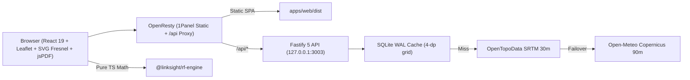

# LinkSight RF — RF Link Budget & Fresnel Zone Planner

Interactive browser-based RF engineering workbench for planning **Point-to-Point (PtP)** and **Single-Repeater Relay (TX → Repeater → RX)** VHF, UHF, 900 MHz SCADA, and 5.8 GHz microwave links over real topographic elevation data.

## Highlights

- **Interactive Topographic Map (Leaflet):** Draggable TX, Repeater, and RX site markers with 4 basemap layers (`ESRI World Topo`, `ESRI Satellite`, `OpenStreetMap`, `ESRI Dark Gray`), status-colored hop vectors, automatic **worst Fresnel obstruction warning pins**, and live bidirectional chart-to-map crosshair synchronization.
- **Terrain Elevation & Fresnel Profile Engine:** Real-time SVG cross-section plotting ground elevation, urban/forest clutter, Earth curvature bulge ($k$-factor `4/3`, `1.0`, `2/3`), Line-of-Sight ray, **1st Fresnel Zone ($F_1$)**, and **60% $F_1$ clearance corridor**.
- **Relay vs. Direct Comparison:** Automatically evaluates both individual relay hops and the direct TX → RX reference path to quantify fade margin improvement (dB) and Fresnel clearance gain (%).
- **Tower Height Advisor:** Closed-form solver recommending the minimum extra tower height (balanced, TX-only, or RX-only) to restore $\ge 60\%$ $F_1$ clearance, with 1-click auto-apply.
- **Industry RF Link Budget Math:**
  - Free Space Path Loss (`FSPL`) + **ITU-R P.526-15 Single Knife-Edge Diffraction** ($\nu$)
  - Empirical **Okumura-Hata** (150–1500 MHz) & **COST-231 Hata** (1500–2000 MHz) with automatic domain bounds warnings
  - Frequency-dependent coaxial feeder attenuation (`RG-58`, `RG-213`, `LMR-240`, `LMR-400`, `LDF4-50A`, `LDF5-50A`)
  - Live `dBm ↔ Watts` and `dBi ↔ dBd` unit readouts
- **Resilient DEM Caching Proxy (Fastify + SQLite WAL):** Queries OpenTopoData SRTM 30m first, automatically fails over to Open-Meteo Copernicus 90m on rate limits or polar latitudes, caches coordinates at 4-decimal (~11 m) grid resolution in SQLite WAL, and degrades gracefully offline.
- **Zero-Friction Sharing & PDF Site Survey Export:** Share full scenarios via base64url `?s=` links, save presets locally in `localStorage`, and export 2-page A4 **PDF RF Site Survey Engineering Reports** with embedded Fresnel charts and itemized link budgets.

## Architecture



## Workspace Layout

- `packages/rf-engine` — Framework-agnostic TypeScript physics library (geodesy, Fresnel, ITU-R P.526 diffraction, Okumura-Hata / COST-231, coax attenuation, PtP/Relay solver, curated Indonesian presets).
- `apps/api` — Memory-bounded Fastify v5 elevation proxy with Zod validation, `@fastify/helmet`, `@fastify/rate-limit`, and SQLite WAL caching.
- `apps/web` — Vite + React 19 + Tailwind CSS v4 interactive RF workbench, native `<dialog>` modals, and PDF report exporter.
- `deploy/` — PM2 ecosystem file, OpenResty `/api` reverse-proxy config, and static deployment helper script.

## Quick Start

```bash
npm install
npm run build
npm test
```

Run locally in development mode (Vite on `:5173`, Fastify API on `:3003`):

```bash
npm run dev:api
npm run dev:web
```

## Production Deployment (1Panel + PM2)

1. Start the elevation API via PM2:
   ```bash
   pm2 start deploy/ecosystem.config.cjs
   pm2 save
   ```
2. Create the static website (`rf.andresptr.site`) in 1Panel with SSL enabled, add `deploy/openresty-proxy.conf` to its `/api` proxy configuration, and run `bash deploy/sync-web.sh`.
