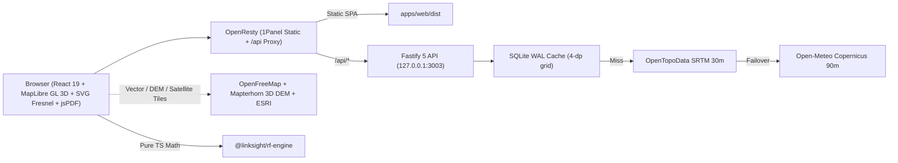

# LinkSight RF — RF Link Budget & Fresnel Zone Planner

Interactive browser-based RF engineering workbench ([`rf.andresptr.site`](https://rf.andresptr.site)) for planning **Point-to-Point (PtP)** and **Single-Repeater Relay (`TX → Repeater → RX`)** VHF, UHF, 915 MHz SCADA, and 5.8 GHz microwave links over real topographic elevation data.

## Highlights

- **Editorial Landing Page & Lazy-Loaded Workbench:** Overview at `/` featuring a live cartographic datum strip, interactive Fresnel/topology showcase preview, 4 curated Indonesian corridor case studies, RF standards strip, and FAQ; the code-split workbench mounts on demand at `/planner` (and `/app`, plus `?s=`, `?preset=`, and `?dialog=` deep links).
- **Interactive 3D Topographic Map (MapLibre GL JS v6):** Full-bleed WebGL canvas with Mapterhorn 3D terrain relief & hillshade (`3D ↔ 2D` toggle), 4 basemap layers (`Topo 3D` via OpenFreeMap Liberty, `Studio` via OpenFreeMap Positron, `Dark` via OpenFreeMap Dark, and `Satellite` via ESRI World Imagery + reference labels), automatic `Topo 3D ↔ Dark` theme sync, draggable TX/Repeater/RX markers with on-map tower height quick-edit popovers, right-click context menu (`Set TX / Repeater / RX here`, `Copy coordinates`), status-colored hop vectors with hover tooltips, automatic **worst Fresnel obstruction warning pins**, camera/compass controls, and live bidirectional chart-to-map crosshair synchronization.
- **Studio Workbench & Keyboard Shortcuts:** Floating HUD layout with compact Top Studio Bar & live KPI ribbon, collapsible Left Inspector Drawer (`Sites` / `Radio` / `Budget` tabs), resizable & collapsible Bottom Fresnel Profile Drawer (`normal` / `expanded` / `minimized`), native `<dialog>` **Command Palette** (`Cmd/Ctrl+K`), inspector toggle (`Cmd/Ctrl+\`), and full-map Presentation / Zen mode (`Cmd/Ctrl+.`).
- **Terrain Elevation & Fresnel Profile Engine:** Real-time SVG cross-section with interactive layer toggles (`F1`, `60% F1`, `Clutter`, `Earth Bulge`) plotting ground elevation, urban/forest clutter, Earth curvature bulge ($k$-factor `4/3`, `1.0`, `2/3`), Line-of-Sight ray, **1st Fresnel Zone ($F_1$)**, and **60% $F_1$ clearance corridor**.
- **Relay vs. Direct Comparison & Per-Site Hardware Tuning:** Evaluates both individual relay hops and the direct `TX → RX` reference path to quantify fade margin improvement (dB) and Fresnel clearance gain (%), with independent or synchronized per-site TX/Repeater/RX radio power, sensitivity, antenna gain, coaxial feeder, connector, and duplexer loss controls.
- **Tower Height Advisor:** Closed-form solver recommending minimum extra tower height (balanced, plus feasible TX-only or RX-only estimates) to restore $\ge 60\%$ $F_1$ clearance, with 1-click auto-apply.
- **Industry RF Link Budget Math:**
  - Free Space Path Loss (`FSPL`) + **ITU-R P.526-15 Single Knife-Edge Diffraction** ($\nu$)
  - Empirical **Okumura-Hata** (150–1500 MHz) & **COST-231 Hata** (1500–2000 MHz) with automatic domain bounds warnings
  - Frequency-dependent coaxial feeder attenuation (`RG-58`, `RG-213`, `LMR-240`, `LMR-400`, `LDF4-50A`, `LDF5-50A`, plus `INTEGRATED` dish mounts)
  - Built-in equipment profiles (`VHF 150 MHz MOTOTRBO`, `UHF 450 MHz Capacity Plus`, `915 MHz Industrial SCADA`, `5.8 GHz PtP Microwave`), 4 curated Indonesian scenarios, and live `dBm ↔ Watts` / `dBi ↔ dBd` readouts
- **Resilient DEM Caching Proxy (Fastify v5 + SQLite WAL):** Trust-proxy per-IP rate limiting, global OpenTopoData SRTM 30m request pacing with single-flight deduplication, automatic failover to Open-Meteo Copernicus 90m, bounded 4-decimal (~11 m) SQLite WAL cache with automatic TTL/row-cap pruning, and offline synthetic fallback.
- **Zero-Friction Sharing, Draft Recovery & Lazy PDF Export:** Share full scenarios via base64url `?s=` links or `?preset=` deep links, auto-save active drafts and named presets in `localStorage`, and export 2-page A4 **PDF RF Site Survey Engineering Reports** via an on-demand lazy-loaded `jsPDF` chunk with print-resolved SVG charts.

## Architecture



## Routes & Keyboard Shortcuts

| Route / Shortcut | Purpose |
| --- | --- |
| `/` | Editorial landing page with live datum strip and interactive Fresnel showcase |
| `/planner` or `/app` | Lazy-loaded interactive MapLibre 3D RF workbench |
| `/?s=<base64url>` | Backwards-compatible shared scenario link (mounts workbench directly) |
| `/planner?preset=<id>` | Launch workbench directly into a curated corridor preset |
| `/planner?dialog=formulas\|scenarios` | Open the RF Math & Methodology or Scenarios dialog on load |
| `Cmd/Ctrl + K` | Open the Command Palette |
| `Cmd/Ctrl + \` | Toggle the Left Inspector Drawer |
| `Cmd/Ctrl + .` | Toggle Presentation / Zen mode (full-bleed map) |

## API Endpoints

| Method & Path | Description |
| --- | --- |
| `GET /api/health` | Service health check, SQLite WAL cache entry count, and uptime (exempt from rate limits) |
| `POST /api/elevation/profile` | Batch elevation lookup for `2–200` `{ lat, lng }` coordinates with single-flight coalescing |
| `GET /api/elevation/point?lat=&lng=` | Single-point ground elevation query returning elevation (`m`), DEM source, cache hit ratio, and fallback status |

## Workspace Layout

- `packages/rf-engine` — Framework-agnostic TypeScript physics library (geodesy, Fresnel, ITU-R P.526 diffraction, Okumura-Hata / COST-231, coax attenuation, PtP/Relay solver, equipment presets, and 4 curated Indonesian scenarios).
- `apps/api` — Memory-bounded Fastify v5 elevation proxy with Zod validation, `@fastify/helmet`, `@fastify/rate-limit`, and SQLite WAL caching.
- `apps/web` — Vite + React 19 + Tailwind CSS v4 editorial landing page (`/`), lazy-loaded MapLibre GL JS v6 3D studio workbench (`/planner`), Command Palette, native `<dialog>` modals, and lazy `jsPDF` report exporter.
- `deploy/` — PM2 ecosystem config (`ecosystem.config.cjs`), OpenResty `/api` reverse-proxy snippet (`openresty-proxy.conf`), security/CSP header include (`openresty-site-headers.inc`), and static sync script (`sync-web.sh`).
- `.github/workflows/ci.yml` — GitHub Actions CI running typecheck, unit/integration tests, and production build on `main`.

## Quick Start & Verification

Requires **Node.js `>= 22.0.0`**:

```bash
npm install
npm run typecheck
npm test
npm run build
```

Run locally in development mode (Vite on `127.0.0.1:5173`, Fastify API on `127.0.0.1:3003`):

```bash
npm run dev:api
npm run dev:web
```

## Production Deployment (1Panel + PM2)

1. Start the elevation API via PM2:
   ```bash
   pm2 start deploy/ecosystem.config.cjs
   pm2 save
   ```
2. Create the static website (`rf.andresptr.site`) in 1Panel with SSL enabled, include `deploy/openresty-proxy.conf` for the `/api` reverse proxy and `deploy/openresty-site-headers.inc` for security/CSP headers (allowing MapLibre web workers plus OpenFreeMap, Mapterhorn, and ESRI tile origins), then build and sync the static bundle:
   ```bash
   npm run build
   bash deploy/sync-web.sh
   ```
